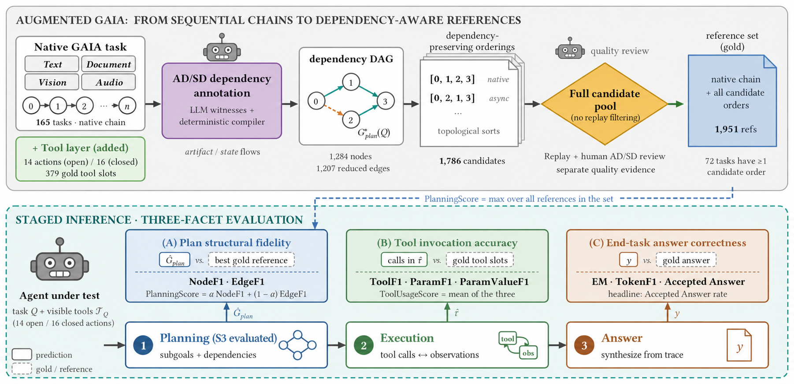

# Beyond Sequential Plans

Anonymous experimental framework for WWW 2027 review. The framework evaluates
planning structure, tool invocation, and final-answer correctness separately.
GAIA is the main benchmark; TaskBench and UltraTool provide auxiliary checks.

This release contains source code, synthetic tests, and
[manuscript-aligned core aggregate results](results/README.md). Individual model
responses, execution trajectories, paper sources, and gated benchmark data are
distributed separately.



The [PDF](docs/assets/framework_overview.pdf) and
[SVG](docs/assets/framework_overview.svg) versions use the same current
reference counts and group-specific response policy. Replay and human review
provide separate evidence; neither filters the main reference pool.

## Installation

Use Python 3.10 or newer:

```bash
python -m venv .venv
source .venv/bin/activate
pip install -r requirements.txt
```

Optional tool backends require their corresponding dependencies, including
`poppler-utils`, `ffmpeg`, `tesseract-ocr`, Graphviz, and browser installation:

```bash
playwright install chromium
```

## Framework

| Path | Purpose |
|---|---|
| `src/inference/` | S1 abstract planning, S2 tool assessment, S3 concrete planning, S4 tool execution, S5 answer synthesis |
| `src/evaluation/` | Planning, tool-use, answer metrics, and recorded ordering references |
| `scripts/exp.sh` | Configurable inference and evaluation entrypoint, including the nine-model cohort |
| `scripts/repair_predictions.py` | Saved-answer normalization and one fixed technical repair attempt per selected case |
| `scripts/prepare_gaia_from_official.py` | Rebuild local inputs from official GAIA and matching controlled annotations |
| `scripts/prepare_crossbench.py` | TaskBench and UltraTool adapters |
| `configs/www2027.json` | Cohort, stage budgets, and reference policy |
| `docs/protocol.md` | Execution, technical repair, evidence, and evaluation details |
| `results/www2027/` | Main and appendix aggregate tables aligned to the manuscript |
| `release/www2027/` | Source snapshot, file manifest, and checksums |

## Data preparation

Obtain GAIA from the [official gated dataset](https://huggingface.co/datasets/gaia-benchmark/GAIA)
under its access conditions. Set `GAIA_SOURCE`, `GAIA_ANNOTATIONS`, and
`GAIA_ORDERING_SCHEDULE` to your local official snapshot, matching controlled
annotation directory, and recorded ordering schedule:

```bash
python scripts/prepare_gaia_from_official.py \
  --gaia-source "$GAIA_SOURCE" \
  --annotation-root "$GAIA_ANNOTATIONS" \
  --ordering-schedule "$GAIA_ORDERING_SCHEDULE" \
  --reference-view current --output-root data/Augmented
```

The experiment reference version contains 165 tasks, 165 Native references and
1,786 candidate orderings. There are 72 tasks with a candidate and 63 with at
least two. Questions, answers, attachments, annotations, and the matching
schedule are not bundled in this source release. Do not substitute an unrelated
annotation or reference version. See [the annotation guide](annotations/README.md).

## Run inference

Configure the model route through environment variables. Keep credentials and
deployment addresses outside tracked files. For an OpenAI-compatible endpoint:

```bash
export LLM_API_BASE="https://your-endpoint.example/v1"
export LLM_API_KEY="<YOUR_API_KEY>"
export MODEL_ID="<EXACT_MODEL_ID>"
export GAIA_DATA_ROOT="data/Augmented"

ANSWER_VERIFIER_MODEL="" bash scripts/exp.sh \
  --dataset gaia_cat_A --dataset gaia_cat_B \
  --dataset gaia_cat_C --dataset gaia_cat_D \
  --mode answer --backend api --provider-profile openai_compatible \
  --model "$MODEL_ID" --remote-only --max-turns 15 --tool-scope record \
  --plan-source stage3
```

Use `bash scripts/exp.sh --paper-models --dry-run` to inspect the nine-model
inventory. Route each model to a compatible deployment. Vision, reasoning, and
audio helper configuration is described in [the protocol](docs/protocol.md).

The source includes JSON-first parsing, non-mutating graph normalization,
root-graph handling, checkpoint repair, and per-request generation evidence.
New inference is a new experiment: preserve the exact model, decoding settings,
tools, task inputs, reference schedule, and all saved traces.

## Technical repair

First inspect normalization and technically selected cases without model calls:

```bash
python scripts/repair_predictions.py --input /path/to/predictions.jsonl \
  --output-dir /path/to/new-selection --select-only
```

To apply the fixed-attempt protocol, use another new directory and specify the
same model that generated the checkpoint:

```bash
python scripts/repair_predictions.py --input /path/to/predictions.jsonl \
  --output-dir /path/to/new-repair --model "$MODEL_ID"
```

Selection and promotion depend on technical defects and upstream preservation,
with at most one new attempt per selected case. They do not use gold answers,
answer correctness, or planning scores. Original checkpoints, raw attempts,
decision streams, and promotion decisions are retained. Historical checkpoints
can have different first-pass budgets; rerunning the framework does not recreate
past service responses.

## Evaluation

For fixed predictions, evaluate Native and every candidate ordering separately:

```text
PlanningScore = (NodeF1 + EdgeF1) / 2
AugmentedScore = max(PlanningScore over Native and every candidate)
ToolUsageScore = (ToolF1 + ParamF1 + ValueF1) / 3
```

Node alignment is shared across references. Exact ties prefer Native, then the
lower candidate rank. S3 is the main pre-execution planning measurement; S1 is
an auxiliary abstract-plan diagnostic. Pass `--gaia_ordering_schedule` to `src.evaluation.runner` or
`--gaia-ordering-schedule` to `scripts/exp.sh`. The older two-reference interface
is a different diagnostic and cannot replace this recorded multi-order schedule.

Open-weight answer results use the synthesized S5 `pred.final_answer`.
Closed-model answer results use the recorded submitted response, falling back
to the recorded final response when no submission exists. Human review is
separate from automatic exact matching and is matched to the same response
field within each group. A native S4 submission is retained as separate
evidence for open-weight runs. Reference selection uses the full candidate set; replay and
human semantic review remain separate evidence. A completed execution does not
certify an ordering's semantics.

## Offline checks

```bash
python scripts/utils/smoke_test_optional_arg_normalization.py
python scripts/utils/smoke_test_recorded_orderings.py
python -m unittest discover -s tests -v
```

These checks use synthetic records and mocked generation, without paid model
calls. They do not exercise live external tools or guarantee identical service
responses. See `release/www2027/VALIDATION.json` for executed checks.

## License

Code is distributed under [LICENSE](LICENSE). Upstream datasets retain their
own licenses and access requirements.
