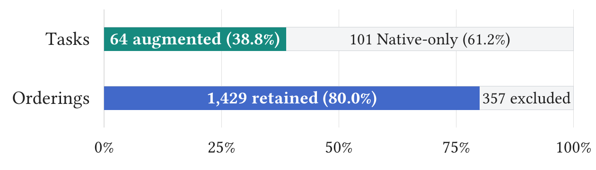
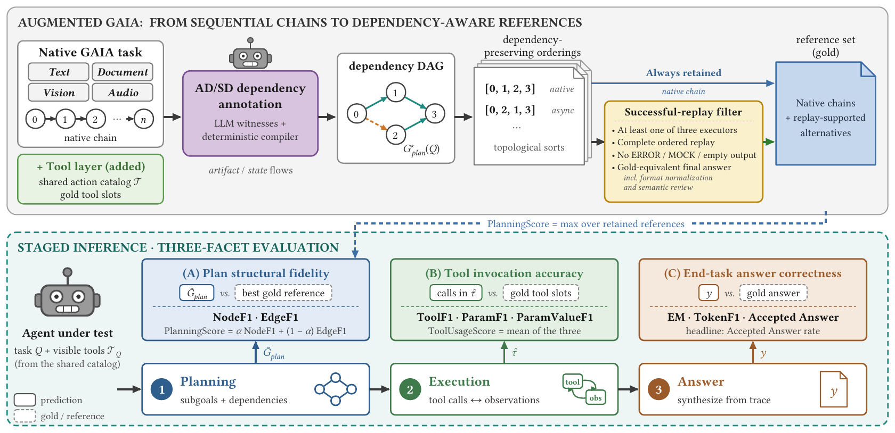
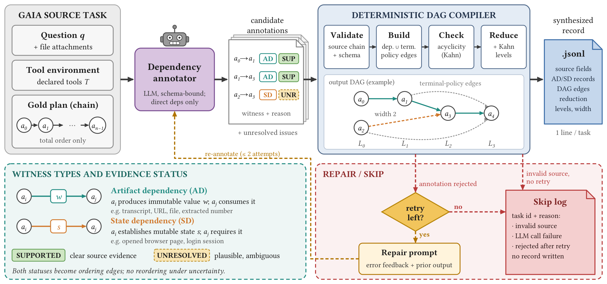

# Beyond Sequential Plans: A Three-Facet Evaluation of Agentic Planning under Dependency-Preserving Augmentation

Anonymous experimental framework for WWW 2027 review. The framework evaluates
planning structure, tool invocation, and final-answer correctness separately.
GAIA is the main benchmark; TaskBench and UltraTool provide auxiliary checks.

This release contains source code, synthetic tests,
[manuscript-aligned aggregate results](results/README.md), and the
[final reference schedule](references/README.md).
Individual model responses, execution trajectories, and gated benchmark data
are distributed separately.

## Final reference set

The figures, tables, configuration, and released schedules use the same reference set:

<!-- FINAL_REFERENCE_COUNTS_START -->
| Item | Count | Scope |
|---|---:|---|
| GAIA tasks | **165** | All tasks remain in evaluation |
| Sampled non-native candidates | **1,786** | Before retention; 72 tasks |
| Replay-retained alternatives | **1,429** | After retention; 64 tasks |
| Excluded alternatives | **357** | Sampled candidates that are not retained |
| Native chains | **165** | Always retained |
| Final scoring references | **1,594** | 165 Native + 1,429 alternatives |
| Alternative retention rate | **80.01%** | 1,429 / 1,786; not task-answer accuracy |
<!-- FINAL_REFERENCE_COUNTS_END -->

A retained alternative has at least one complete, ordered, gold-equivalent
replay by the three-executor committee, with no flagged ERROR, MOCK, or empty
tool output. The final rule is an at-least-one-success union. All evaluated
configurations use the same retained reference set.

The [count ledger](references/reference_counts.json),
[complete reference CSV](references/reference_set_1594.csv), and
[evaluator schedule](references/ordering_schedule.json) make these counts
independently checkable. The published result exports contain **10 tables, 87 aggregate rows**, including
the 20-configuration tool-threshold sensitivity analysis.



[Vector coverage figure](docs/assets/reference_coverage_1786_1429.pdf).



The overview summarizes reference construction and three-facet evaluation. A vector
[PDF](docs/assets/overview_figure_final_1594.pdf) is also available. It depicts
successful-replay filtering followed by evaluation over Native chains and
retained alternatives. The manuscript and [result tables](results/README.md)
define the exact statistics and reference policy.

The dependency-synthesis workflow is shown in the original pipeline diagram:



## Installation

Use Python 3.10 or newer:

```bash
python -m venv .venv
source .venv/bin/activate
pip install -r requirements.txt
```

Optional tool backends require their corresponding dependencies, including
`poppler-utils`, `ffmpeg`, `tesseract-ocr`, Graphviz, and browser installation:

```bash
playwright install chromium
```

## Framework

| Path | Purpose |
|---|---|
| `src/inference/` | S1 abstract planning, S2 tool assessment, S3 concrete planning, S4 tool execution, S5 answer synthesis |
| `src/evaluation/` | Planning, tool-use, answer metrics, and recorded ordering references |
| `scripts/exp.sh` | Configurable inference and evaluation entrypoint, including the nine-model cohort |
| `scripts/repair_predictions.py` | Saved-answer normalization and one fixed technical repair attempt per selected case |
| `scripts/prepare_gaia_from_official.py` | Rebuild local inputs from official GAIA and matching controlled annotations |
| `scripts/prepare_crossbench.py` | TaskBench and UltraTool adapters |
| `configs/www2027.json` | Cohort, stage budgets, and reference policy |
| `references/` | Final retained candidates, complete reference CSV, and evaluator-ready JSON schedule |
| `docs/protocol.md` | Execution, technical repair, evidence, and evaluation details |
| `results/www2027/` | Main and appendix aggregate tables aligned to the manuscript |
| `release/www2027/` | Source/result snapshots, file manifest, and checksums |

## Data preparation

Obtain GAIA from the [official gated dataset](https://huggingface.co/datasets/gaia-benchmark/GAIA)
under its access conditions. Set `GAIA_SOURCE` and `GAIA_ANNOTATIONS` to your
official snapshot and matching controlled annotation directory. Use the
published final schedule:

```bash
python scripts/prepare_gaia_from_official.py \
  --gaia-source "$GAIA_SOURCE" \
  --annotation-root "$GAIA_ANNOTATIONS" \
  --ordering-schedule references/ordering_schedule.json \
  --reference-view current --output-root data/Augmented
```

The reference set contains 165 tasks and 1,594 references:
165 Native chains plus 1,429 retained alternatives. There are 64 tasks with a
retained alternative and 56 with at least two. The sampled pool contained
1,786 candidates on 72 tasks. The original 63-task rich cohort remains fixed
for the corresponding comparison; it is distinct from the 56-task retained-rich
budget experiment. Questions, answers, attachments, and source annotations are
not bundled. Use source annotations matching the recorded schedule. See the
[annotation guide](annotations/README.md) and [final reference policy](docs/reference_policy.md).

## Run inference

Configure the model route through environment variables. Keep credentials and
deployment addresses outside tracked files. For an OpenAI-compatible endpoint:

```bash
export LLM_API_BASE="https://your-endpoint.example/v1"
export LLM_API_KEY="<YOUR_API_KEY>"
export MODEL_ID="<EXACT_MODEL_ID>"
export GAIA_DATA_ROOT="data/Augmented"

ANSWER_VERIFIER_MODEL="" bash scripts/exp.sh \
  --dataset gaia_cat_A --dataset gaia_cat_B \
  --dataset gaia_cat_C --dataset gaia_cat_D \
  --mode answer --backend api --provider-profile openai_compatible \
  --model "$MODEL_ID" --remote-only --max-turns 15 --tool-scope record \
  --plan-source stage3
```

Use `bash scripts/exp.sh --paper-models --dry-run` to inspect the nine-model
inventory. Route each model to a compatible deployment. Vision, reasoning, and
audio helper configuration is described in [the protocol](docs/protocol.md).

The source includes JSON-first parsing, non-mutating graph normalization,
root-graph handling, checkpoint repair, and per-request generation evidence.
New inference is a new experiment: preserve the exact model, decoding settings,
tools, task inputs, reference schedule, and all saved traces.

## Technical repair

First inspect normalization and technically selected cases without model calls:

```bash
python scripts/repair_predictions.py --input /path/to/predictions.jsonl \
  --output-dir /path/to/new-selection --select-only
```

To apply the fixed-attempt protocol, use another new directory and specify the
same model that generated the checkpoint:

```bash
python scripts/repair_predictions.py --input /path/to/predictions.jsonl \
  --output-dir /path/to/new-repair --model "$MODEL_ID"
```

Selection and promotion depend on technical defects and upstream preservation,
with at most one new attempt per selected case. They do not use gold answers,
answer correctness, or planning scores. Checkpoints, raw attempts, decision streams, and promotion decisions are
retained. Record the actual first-pass generation budgets with each checkpoint;
new model calls produce new experimental responses.

## Evaluation

For fixed predictions, evaluate Native and every retained ordering separately:

```text
PlanningScore = (NodeF1 + EdgeF1) / 2
AugmentedScore = max(PlanningScore over Native and retained alternatives)
ToolUsageScore = (ToolF1 + ParamF1 + ValueF1) / 3
```

Node alignment is shared across references. Exact ties prefer Native, then the
lower candidate rank. S3 is the main pre-execution planning measurement; S1 is
an auxiliary abstract-plan diagnostic. Pass
`--gaia_ordering_schedule references/ordering_schedule.json` to `src.evaluation.runner`
or `--gaia-ordering-schedule references/ordering_schedule.json` to `scripts/exp.sh`.
Use the recorded multi-order schedule for per-task maximum-reference scoring.

Open-weight answer results use the synthesized S5 `pred.final_answer`.
Closed-model answer results use the recorded submitted response, falling back
to the recorded final response when no submission exists. Human review is
separate from automatic exact matching and is matched to the same response
field within each group. A native S4 submission is retained as separate
evidence for open-weight runs. Reference selection uses the published retained
pool. An alternative is retained when at least one of the three executors
completes its specified ordering without flagged ERROR, MOCK, or empty tool
output and returns a gold-equivalent answer. All Native chains are retained.
Human semantic review is complementary evidence; successful replay does not
certify every dependency or step's semantics.

## Offline checks

```bash
python scripts/utils/smoke_test_optional_arg_normalization.py
python scripts/utils/smoke_test_recorded_orderings.py
python -m unittest discover -s tests -v
```

These checks use synthetic records and mocked generation, without paid model
calls. They do not exercise live external tools or guarantee identical service
responses. See `release/www2027/VALIDATION.json` for executed checks.

## License

Code is distributed under [LICENSE](LICENSE). Upstream datasets retain their
own licenses and access requirements.
